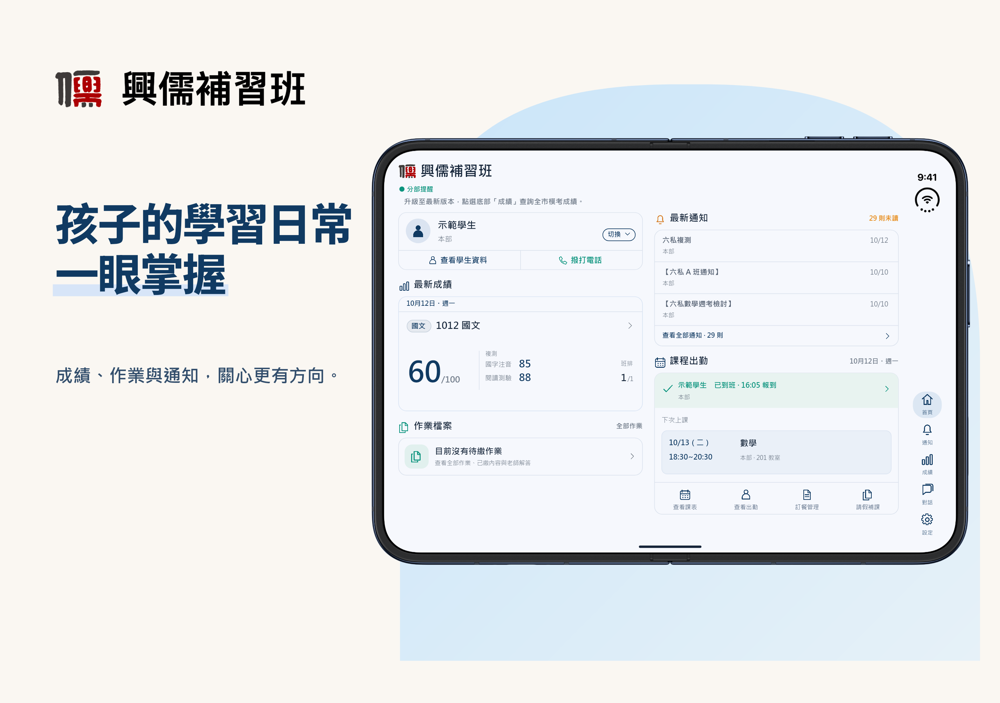

# Edison Lee

**Full Stack Engineer · Sole Developer of ED-PULSE**

I independently designed and developed **ED-PULSE**, a complete commercial education management system spanning web, mobile, and backend services.

My work covers system architecture, interface design, application development, data modeling, deployment, and ongoing maintenance.

## ED-PULSE

A multi-tenant platform connecting staff, students, and parents through academic management, communication, and administrative workflows.

*HSINRU+ product interface mockup featuring a demo student profile.*

### Engineering highlights

- **End-to-end product development:** Independently taking the system from architecture and interface design through implementation, deployment, and maintenance.
- **Web and mobile applications:** Connected experiences for education operations across browsers and mobile devices.
- **Multi-tenant capabilities:** Support for different organizations, user roles, and access requirements.
- **Reliable business workflows:** A focus on data integrity, real-time communication, testing, and operational stability.

*Source code and internal implementation details are proprietary.*

## Core stack

| Area | Technologies |
| --- | --- |
| Web | TypeScript, React, Next.js, Nx, Tailwind CSS, shadcn/ui |
| Mobile | React Native, Expo |
| Backend | Node.js, Express, Prisma, MySQL, Redis |
| Delivery | Docker, Google Cloud, Jest, Cypress, Sentry |

## Contact

[edison@ed-pulse.com](mailto:edison@ed-pulse.com)
