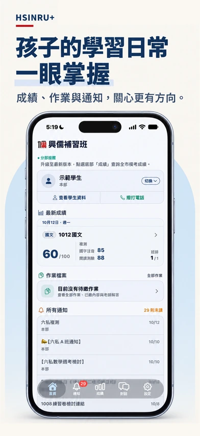
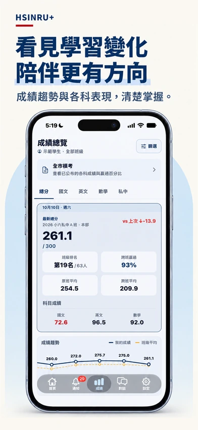
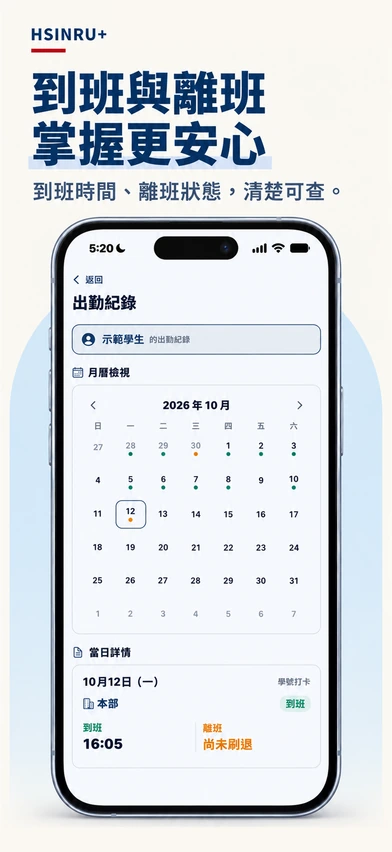
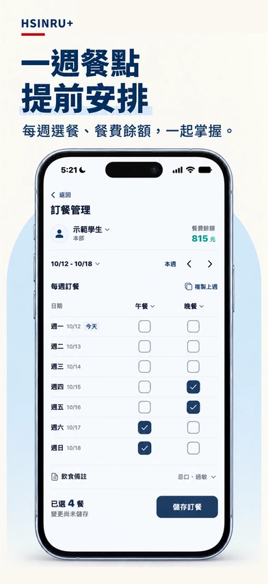

# Edison Lee

**Full Stack Engineer · Sole Developer of ED-PULSE**

I independently design, develop, and maintain **ED-PULSE**, a complete commercial education management platform spanning web, mobile, and backend services.

[edison@ed-pulse.com](mailto:edison@ed-pulse.com)

## ED-PULSE

A platform for academic operations, administration, and communication between staff, students, and parents.

**Used by Hsinru Cram School (興儒補習班).** The product presentation below shows the school's HSINRU+ application.

  
  
  

  
More product views · Meal planning and chat

  

    
    
  

*Customer product presentations featuring demo student profiles. Select an image to view it at full size.*

### Engineering focus

- **Multi-tenant applications:** Organization-aware workflows and role-based access.
- **Real-time communication:** Messaging and notifications across web and mobile.
- **Production ownership:** Data integrity, regression testing, deployment, and ongoing maintenance.

## Tech stack

| Area | Technologies |
| --- | --- |
| Web | TypeScript, React, Next.js, Nx, Tailwind CSS, shadcn/ui |
| Mobile | React Native, Expo |
| Backend | Node.js, Express, Prisma, MySQL, Redis |
| Delivery | Docker, Google Cloud, Jest, Cypress, Sentry |

*Source code and internal implementation details are proprietary.*
